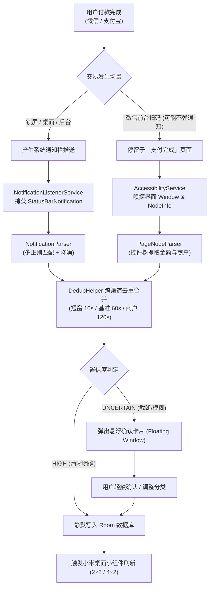

# 小米 15 Pro (HyperOS 2 / Android 15) 自动记账技术调研与架构方案

> 本文档基于酷安（Coolapk）、Linux.do、GitHub 开源社区（`huanghhcri/SmartLedger`、`AutoAccountingOrg/AutoAccounting`）及商业软件「钱迹」的实践经验，针对 **小米 15 Pro（骁龙 8 至尊版 / HyperOS 2 / Android 15）** 的真机环境与限制，梳理出的自动记账落地全景调研。

---

## 1. 调研背景与核心目标

### 1.1 核心需求
- **核心场景**：在微信支付、支付宝支付完成后，手机能够在无感或极低干预下，自动解析出**金额、交易流向（支出/收入）、商户/收款方、支付渠道（微信/支付宝/银行卡）**并记入本地账本。
- **目标设备**：小米 15 Pro
  - 操作系统：Xiaomi HyperOS 2.0（基于 Android 15，API 35）
  - 屏幕规格：6.73 英寸全等深微曲屏，3200 × 1440 物理分辨率，约 560 dpi 默认虚拟密度
  - 系统限制：国内未解锁 Bootloader（不支持 Root / 传统 Xposed），拥有激进的后台管控机制与严格的权限围墙。

### 1.2 调研结论概览
自动记账在 Android 上**完全可行且有大量成熟落地经验**。最稳定、侵入性最低且最抗微信/支付宝版本变动的路线为：
$$\text{通知栏监听 (主流)} + \text{无障碍节点嗅探 (辅助补漏)} + \text{跨渠道多维去重} + \text{本地离线优先存储}$$

---

## 2. 社区标杆方案深度剖析

| 项目 / 标杆 | 核心技术栈 | 采集方式 | 对小米 15 Pro 的借鉴价值 |
| :--- | :--- | :--- | :--- |
| **[`SmartLedger`](https://github.com/huanghhcri/SmartLedger)** | Kotlin + Jetpack Compose + Room | `NotificationListenerService` | **最高价值模板**。技术栈与我们完全一致；自带成熟的多渠道通知正则库、跨渠道去重算法与保活看门狗。 |
| **[`AutoAccounting`](https://github.com/AutoAccountingOrg/AutoAccounting)** (Ankio) | Kotlin + 多模块 | Xposed / Shizuku / 无障碍 / 通知 | 沉淀了历代微信与支付宝支付完成页的 `AccessibilityNodeInfo` 节点解析规则，适合作为无障碍解析的参考库。 |
| **「钱迹」商业版 (Qianji)** | Android 原生 | 无障碍服务 + 悬浮窗确认 | 验证了商业化闭环体验，其针对 HyperOS 提出的 **`WRITE_SECURE_SETTINGS` ADB 防掉线** 是解决小米无障碍易被杀的终极方案。 |

---

## 3. 核心机制流转设计

### 3.1 采集双通道模型


### 3.2 微信与支付宝的实测通知 Payload 差异

#### 微信支付（`com.tencent.mm`）
- **常规通知格式**：
  - `title`: `微信支付`
  - `text`: `微信支付凭证` 或 `已支付¥25.00`、`付款码已支付¥16.00`
  - `bigText`: `向【某某便利店】付款¥25.00`
- **注意陷阱**：
  - 微信在前台主动扫码付款时，因当前处于应用内，微信有时**不会向系统通知中心发送通知**（由应用内声效和完成页代替）。因此无障碍辅助读取是重要的互补通道。
  - 公众号消息和营销推送极易产生干扰，解析器必须排除“支付X元干饭优惠券”等词条。

#### 支付宝（`com.eg.android.AlipayGphone`）
- **常规通知格式**：
  - `title`: `支付宝`
  - `text`: `成功付款25.00元` 或 `你有一笔42.75元的支出`
  - `bigText`: `向【某某商户】成功付款25.00元。支付方式：招商银行储蓄卡(1234)`
- **注意陷阱**：
  - 需严格过滤“蚂蚁森林能量已生成”、“生活缴费提醒”以及积分到账等非交易通知。

---

## 4. 关键算法：跨渠道同笔交易去重（Dedup Engine）

在真实场景中，用户用微信扫码付款，往往会同时收到：
1. 微信支付推送通知（如：`向XX付款¥50.00`）
2. 绑定扣款的银行卡短信或银行 App 推送（如：`【招商银行】您账户尾号1234于...消费人民币50.00元`）

如果不做合并去重，同一笔消费就会被记入两次。`SmartLedger` 验证过的去重算法策略如下：

```kotlin
val window = when {
    sameMerchant -> 120_000L           // 双方商户名称互相包含，窗口放宽到 120 秒
    sameChannel && bothNoMerchant -> 10_000L // 同渠道且都无商户：收紧到 10 秒（防止 30s 内连续两笔 15 元被误并）
    else -> 60_000L                    // 跨渠道基准窗口：60 秒内相同金额自动合并
}
```

并且采用**优先级更新策略**：若已有微信记账（优先级 3），随后收到招商银行通知（优先级 10），则保留单笔记录并将支付方式细化提升为“招商银行”，补全卡号信息。

---

## 5. 小米 15 Pro (HyperOS 2 / Android 15) 专属踩坑与解决方案

社区在小米澎湃系统上踩过无数次坑，总结出的标准对策如下：

### 5.1 「受限制的设置」解除（HyperOS 2 侧载应用防护）
- **现象**：通过本地安装的 APK，在系统“设置 → 辅助功能 / 无障碍”里，开关显示为浅灰色不可点击。
- **解法**：App 需弹出明确引导：
  `长按桌面应用图标 → 应用信息 → 点击右上角 [⋮] 菜单 → 勾选「允许受限制的设置」`。

### 5.2 「后台弹出界面」私有权限（悬浮窗不弹出的罪魁祸首）
- **现象**：即使代码中通过了 `Settings.canDrawOverlays()`，在微信支付完成后，App 在后台尝试拉起悬浮确认框依然被静默吃掉。
- **解法**：引导进入小米专属设置页：
  `应用信息 → 权限管理 → 其他权限 → 将「后台弹出界面」设置为“始终允许”`。

### 5.3 激进后台清理防杀（HyperOS 保活四件套）
1. **自启动**：开启「允许应用自启动」与「允许关联启动」。
2. **省电策略**：从默认的“智能限制”调整为「无限制」。
3. **多任务卡片加锁**：在后台多任务列表长按卡片加锁，防止一键清理被干掉。
4. **ListenerWatchdog 链式看门狗**：
   - 依赖 `AlarmManager.setAndAllowWhileIdle()` 设置 25 分钟链式闹钟。
   - 监听 `ACTION_USER_PRESENT`（用户解锁亮屏）与 `ACTION_BOOT_COMPLETED`。
   - 每次亮屏即刻自检 `NotificationListenerService` 是否存活，死掉则主动向系统重新请求重绑。

### 5.4 ADB `WRITE_SECURE_SETTINGS` 防掉线自愈（高级可选）
针对极客用户，提供一条 ADB 指令：
```bash
adb shell pm grant com.bookkeeping.app android.permission.WRITE_SECURE_SETTINGS
```
一旦授权，当系统省电策略强行关闭了无障碍服务时，App 可以在后台通过修改 `Settings.Secure.ENABLED_ACCESSIBILITY_SERVICES` **实现无感自愈拉起**，达到 100% 不掉线。

---

## 6. 全栈架构与工程落地规范（对齐 e721b190）

沿用我们在 [`e721b190`](conversation://e721b190-467c-459f-a5b4-9d2f99179f10)「暖月」中跑通的成熟架构和部署机制：

### 6.1 客户端技术栈
- **核心框架**：Kotlin 2.0.21 + Jetpack Compose (BOM 2024.12.01) + Material 3
- **本地存储**：Room 2.6.1 (SQLite)，金额以分（`Long`）存储，彻底避免浮点数精度误差
- **架构模式**：MVVM + Repository + Kotlin Flow / Coroutines
- **桌面小组件**：RemoteViews 适配小米 15 Pro（2×2 快捷记账/今日支出，4×2 预算趋势）

### 6.2 服务端与隐私保护
- **服务载体**：复用云服务器（`<YOUR_SERVER_IP>`）+ Cloudflare（`leafy.fxxkopenai.com`）
- **极简服务**：FastAPI + SQLite，暴露端到端加密备份接口（`/api/ledger/backup`）与版本更新接口（`/api/ledger/version`）
- **零知识隐私（E2EE）**：记账数据包含高度敏感的个人收支明细。客户端采用 `PBKDF2-HMAC-SHA256` 派生密钥，使用 `AES-256-GCM` 密文传输与落盘，云端即使被攻破也无法还原账目明细。

### 6.3 部署流水线（`deploy.sh`）
- 一键自动化打包发布：
  `./gradlew assembleRelease` → 计算 SHA256 与文件大小 → 远程 SCP 上传 → 更新 `version.json` → 重启 systemd 服务。
- 客户端启动通过 `WorkManager` 检测更新，通过 `FileProvider` 下载并唤起原生安装器。

---

## 7. 骨架搭建规划

1. **第 1 阶段（工程底座）**：初始化 Gradle 8.11 / Kotlin 2.0 / Compose / Room 工程骨架与本地依赖配置。
2. **第 2 阶段（核心采集与去重）**：落地 `NotificationParser`、`DedupHelper` 及 `PaymentNotificationListener`，并提供本地单测覆盖。
3. **第 3 阶段（权限引导与看门狗）**：实现针对 HyperOS 的权限引导页与 `ListenerWatchdog`。
4. **第 4 阶段（Compose 界面与桌面组件）**：实现首页流水、手动录单与小米 2×2 / 4×2 桌面组件。
5. **第 5 阶段（服务端密文同步与一键部署）**：复用 FastAPI 密文同步与 `deploy.sh` 脚本。

---

## 8. 闭环生态打通与方案 B 官方对账落地（v1.0.3）

### 8.1 闭环生态全场景通知接入
针对不走支付宝/微信的闭环消费体系，扩展通知监听器匹配规则：
- **美团生态**（`com.sankuai.meituan`、`com.sankuai.meituan.takeoutnew`）：涵盖美团支付、美团月付扣款、外卖订单扣款。
- **京东生态**（`com.jingdong.app.mall`、`com.jd.jr`、`com.jd.jdlite`）：涵盖京东白条、京东支付、商城付款通知。
- **抖音生态**（`com.ss.android.ugc.aweme`、`com.ss.android.ugc.live`）：涵盖抖音支付、抖音商城下单、直播间购物扣款。
- **云闪付**（`com.unionpay`）：涵盖银联云闪付刷卡与消费推送。

### 8.2 方案 B：官方对账单 CSV 智能导入与合并去重
- **痛点背景**：微信好友聊天内私聊转账与个人红包，系统通知栏刻意抹去了具体金额（仅显示 `[转账] 请收款`），且用户由于隐私顾虑坚决不愿开启高危的无障碍辅助服务（AccessibilityService）。
- **方案 B 落地架构**：
  1. **零权限隐私友好**：用户无需授予任何屏幕抓取权限，直接在微信/支付宝导出官方个人对账单（CSV）。
  2. **双编码自适应识别**：自动探测并适配 UTF-8（带/不带 BOM）与 GBK/GB18030（支付宝传统格式），无乱码解析。
  3. **双重智能去重**：
     - **精确外键去重**：微信 `交易单号` / 支付宝 `交易号` 为全局唯一索引，重复导入 100% 幂等跳过。
     - **通知近邻模糊合并**：若先前通过通知栏已记入某笔支出（无订单号），但在 ±90 秒内且金额一致，自动将其合并升级，绑定官方唯一交易单号并补充真实商家与商品详情，不产生重复记录。
